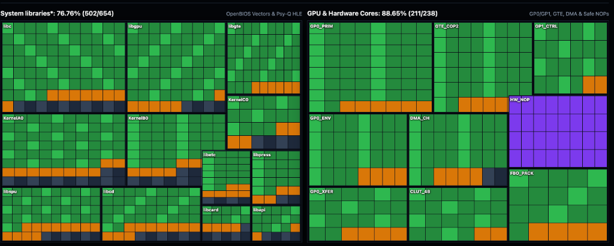

# psx2native-fm

PlayStation 1 static recompilation runtime fork tailored for Square Co., Ltd. 1997 engine architectures (Front Mission Alternative).

Forked from RetroPortingToolkit/psxrecomp (mstan et al.).

> [!IMPORTANT]
> **Static Recompilation & Reverse-Engineering Methodology**
> 
> *A static recompiler serves strictly as the execution engine, while decompilers/disassemblers (Rizin/Ghidra) and custom extractor scripts provide the indispensable navigation and blueprint. Without precise binary ground-truth validation, any static recompilation effort inevitably devolves into blind trial-and-error and undetected regressions.*

---

## 1. Hardware & System Coverage Matrix

<p align="center">
  
</p>

Coverage audit based on verified execution traces of FMA.EXE and runtime subsystem implementations:
- **System Libraries & Kernel (OpenBIOS)**: 76.76% (502 / 654 functions)
- **GPU, DMA & GTE Instructions**: 88.65% (211 / 238 features)
- **Unknown Opcode Safe NOP**: 32 unassigned/padding opcodes mapped to PSX-SPX 1-word NOP bypass (purple cells)

---

## 2. Problem Mapping: 4-Stage GP0 Stream Desynchronization

```
+-------------------------------------------------------------------------------------------------+
| Stage 1: Primitive Header & DMA Tag Length Discrepancy (BATTLE.OVL 0x80070528..0x80070714)    |
| - BATTLE.OVL 0x80070688: lui v1, 0x2800 injects opcode 0x28, but mesh writes 3 vertices (4w)   |
| - Frame 23075 at 0x000C6478: DMA node tag = 9 words, but primitive Word 0 carries opcode 0x20   |
+-------------------------------------------------------------------------------------------------+
                                                │
                                                ▼
+-------------------------------------------------------------------------------------------------+
| Stage 2: Upstream FIFO Desynchronization (psxrecomp base)                                       |
| - gpu_write_gp0 treated GP0 as a continuous stream without DMA node boundary clamping          |
| - Opcode 0x28 expected 5 words; node ended at word 4 -> gpu.c swallowed Word 0 of next node     |
| - Permanent 1-word (32-bit) stream offset across Ordering Table packets                         |
+-------------------------------------------------------------------------------------------------+
                                                │
                                                ▼
+-------------------------------------------------------------------------------------------------+
| Stage 3: Parameter Slippage & Visual Corruption                                                 |
| - Vertex coordinates shifted into Word 0 (Color Tint) -> Solid salmon-red polygon flooding      |
| - Normal coordinates shifted into Word 2 -> Garbage VRAM sampling as CLUT palette               |
| - Empty string ticker underflow in FMA.EXE 0x80017e1c (0 - 32 = 224, CLUT 0x3FFC) -> Barcode   |
+-------------------------------------------------------------------------------------------------+
                                                │
                                                ▼
+-------------------------------------------------------------------------------------------------+
| Stage 4: Recompiler Halt on Projected Negative Coordinates                                      |
| - Negative 32-bit projected vertex Y (Y < -256) arrived while GP0 state was IDLE               |
| - Upper byte 0xFE (e.g. 0xFE37FC9F) or 0xFC parsed as unknown GP0 command                      |
| - Upstream psxrecomp executed psx_fatal_halt() -> Non-standard behavior on real PS1 hardware    |
+-------------------------------------------------------------------------------------------------+
```

---

## 3. Engineering Fixes & Line of Code Mapping

### 3.1. Discrete DMA Linked-List Node Isolation & Game-ID Gating
- **Modified File**: `runtime/src/gpu.c` (lines 4055-4081, 7874-7880; driven by DMA linked-list callback `gpu_set_gp0_linked_list_node` in `runtime/src/dma.c:763` and configured via `gpu_set_game_id`)
- **Mechanism**: Implements `s_ll_in_node` and `s_ll_node_words_remaining`. Decrements remaining count per GP0 word. Gated strictly to `SLPS-00953` (`s_is_fma`), so titles utilizing multi-primitive compound DMA nodes (e.g. Front Mission 3) run on pure continuous PSX-SPX FIFO streams without premature state truncation.

### 3.2. Two-Way Opcode & DMA Node Length Harmonization
- **File**: `runtime/src/gpu.c` (lines 8032-8072)
- **Mechanism**: Gated authoritative arbitration using the DMA linked-list tag length for `SLPS-00953`:
  - 4 words -> `0x20` (Flat Triangle)
  - 5 words -> `0x28` (Flat Quad)
  - 7 words -> `0x24` (Textured Triangle)
  - 9 words -> `0x2C` (Textured Quad)
  - 6 words -> `0x30` (Shaded Triangle)
  - 8 words -> `0x38` (Shaded Quad)
  - 9 words -> `0x34` (Shaded Textured Triangle)
  - 12 words -> `0x3C` (Shaded Textured Quad)

### 3.3. PSX-SPX Hardware-Accurate Unknown Opcode Handling (NOP)
- **File**: `runtime/src/gpu.c` (lines 8074-8082)
- **Mechanism**: PlayStation 1 hardware specification (PSX-SPX GPU) states unlisted commands are treated as 1-word NOPs. Replaced `psx_fatal_halt()` with:
  ```c
  int word_count = gp0_command_word_count(opcode);
  if (word_count == 0) {
      gp0_nop_count++;
      return;
  }
  ```

### 3.4. Font Ticker Underflow Filter
- **File**: `runtime/src/gpu.c` (lines 6323-6325)
- **Mechanism**: In `FMA.EXE 0x80017e1c`, an uninitialized string pointer triggers `0 - 32 = 224`, generating 32 consecutive sprites with `u0 == 0 && v0 == 184 && clut == 0x3FFC`. Filter drops this specific combination to eliminate the vertical comb artifact.

### 3.5. Host VRAM FBO Zeroing
- **File**: `runtime/src/gpu_gl_renderer.c` (lines 5275, 6088, 6193)
- **Mechanism**: Explicit allocation zeroing of `s_up_tex`, `s_raw_tex`, and intermediate FBO targets (`s_hr_fbo`, `s_scratch_fbo`) via `calloc` and `glClear`, matching PS1 power-on VRAM state and eliminating driver garbage on Apple Silicon Metal.

---

## 4. Title Execution Models & Multi-Game Architecture

### 4.1. Front Mission Alternative (`SLPS-00953`)
```
Game Disc Layout:
├── SLPS_009.53 (40 KB)  --> Recompiled ahead-of-time (AOT) to native C
└── FMA.EXE     (224 KB) --> Dynamically loaded at 0x80010000 via Tier-2 LLE Interpreter
    ├── BATTLE.OVL (0x80065800)
    ├── GBASE.OVL  (0x80065800)
    └── TITLE.OVL  (0x80065800)
```
- `SLPS_009.53` operates as a stage-1 bootloader.
- Main engine (`FMA.EXE`) is loaded from `.A` container archives using the verified sector table at `0x8003cabc`.
- Combat subroutines run via overlay rebasing at `0x80065800`.
- Requires FMA-specific opcode harmonization to reconcile mismatched `0x28` headers.

### 4.2. Front Mission 3 (`SLUS-01011`)
```
Game Disc Layout:
├── SLUS_010.11 (872 KB, 0x80010000..0x800E4800) --> Recompiled AOT (4,334 functions, 68 C shards)
└── \OVL\ (14 Overlays, Square 'MWo1' Magic 0x316F574D)
    ├── Tier-1 Overlays (Base 0x8014D000):
    │   ZTIT.BIN, ZSTUP.BIN, ZNET.BIN, SCMAP.BIN, SENT.BIN,
    │   YAREA.BIN, YMV.BIN, YSL.BIN, IEFF.BIN, ZRES.BIN
    └── Tier-2 Overlays (Base 0x80159000):
        ZMAIL.BIN, ZNMAP.BIN, ZNAM.BIN, NEND.BIN
```
- **Polygon Builder Ground Truth (`SLUS_010.11:0x80035DEC..0x800361C0`)**:
  - `0x80035DEC`: `POLY_FT3` (DMA tag length 7 words, Opcode `0x24`, Stride 8 words).
  - `0x80035F04`: `POLY_FT4` (DMA tag length 9 words, Opcode `0x2C`, Stride 10 words).
  - `0x80036170`: `POLY_GT4` (DMA tag length 12 words, Opcode `0x3C`, Stride 13 words).
- **Compound Ordering Table Architecture**:
  - FM3 batches Environment commands (`0xE1` Texpage) and multiple sequential primitives within single DMA linked-list nodes.
  - Gated isolation preserves continuous PSX-SPX FIFO parsing, preventing the solid red polygon flood, stretched texture spikes, and missing geometry columns caused by cross-node word truncation.

---

## 5. Build & Verification

### Build
```bash
cmake -B build -DCMAKE_BUILD_TYPE=Release
cmake --build build -j$(nproc 2>/dev/null || sysctl -n hw.ncpu)
```

### Verification
1. **Visual Parity**: Verify hangar cutscene renders without red polygon flooding and dialogue boxes render without vertical barcode lines.
2. **Crash Regression**: Advance past frame 23075 in combat missions; verify no `0xFE` or `0xFC` halts occur.
3. **TCP Debug Server**: Connect to port 4370 while the process is active:
   ```bash
   python3 tools/debug_client.py gpu
   python3 tools/debug_client.py frame
   ```

---

## 6. License & Attribution

- **psx2native-fm & psxrecomp**: Licensed under the **PolyForm Noncommercial License 1.0.0** (Copyright (c) 2026 Matthew Stanley). See [LICENSE](LICENSE) for full legal text.
- **Upstream Project**: [RetroPortingToolkit/psxrecomp](https://github.com/RetroPortingToolKit/psxrecomp) by Matthew Stanley (mstan) and the RetroPortingToolkit collective.
- **Third-Party Components**:
  - Bundled OpenBIOS: LGPL v2.1.
  - libchdr: BSD-3-Clause.
  - toml11: MIT License.
  - See [THIRD_PARTY_ATTRIBUTION.md](THIRD_PARTY_ATTRIBUTION.md) for complete third-party dependency notices.
- **Asset Policy**: This repository does not distribute copyrighted PlayStation game assets, disc images, or proprietary Sony BIOS ROMs.
- **Trademarks & Disclaimer**: PlayStation is a registered trademark of Sony Interactive Entertainment Inc. Front Mission is a registered trademark of Square Enix Co., Ltd. This project is an independent noncommercial research and interoperability effort under PolyForm Noncommercial 1.0.0, and is not affiliated with, endorsed by, or connected to Sony Interactive Entertainment or Square Enix.
